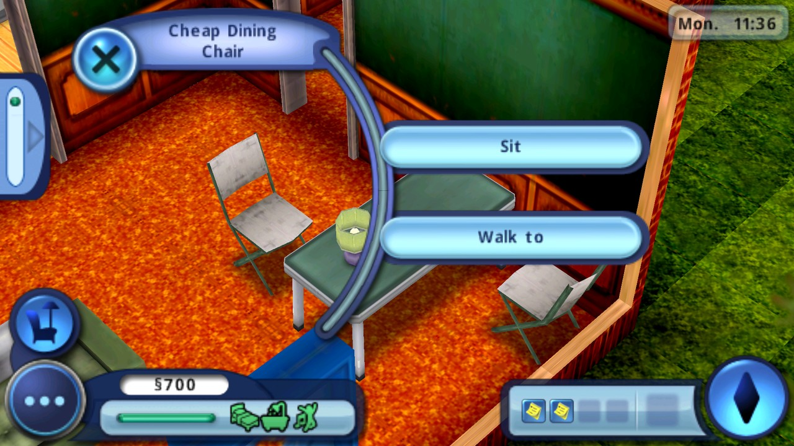
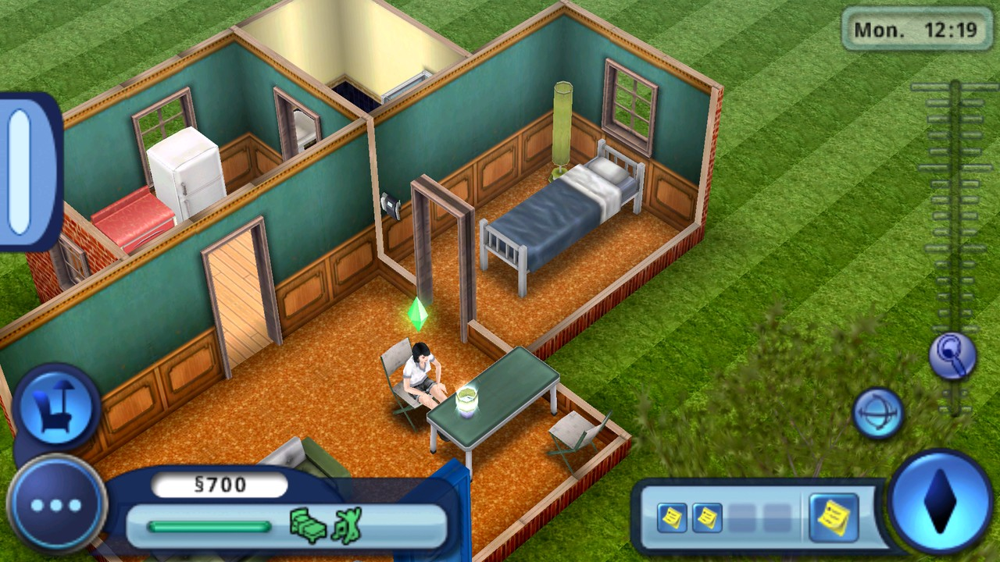
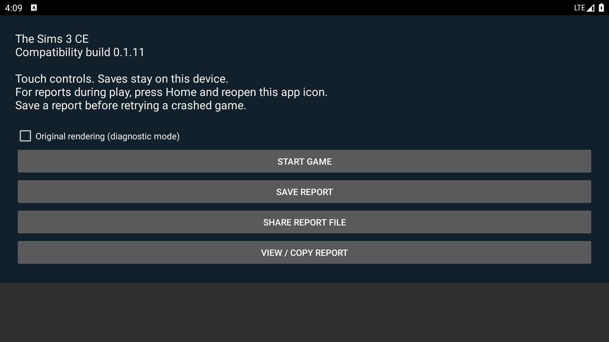
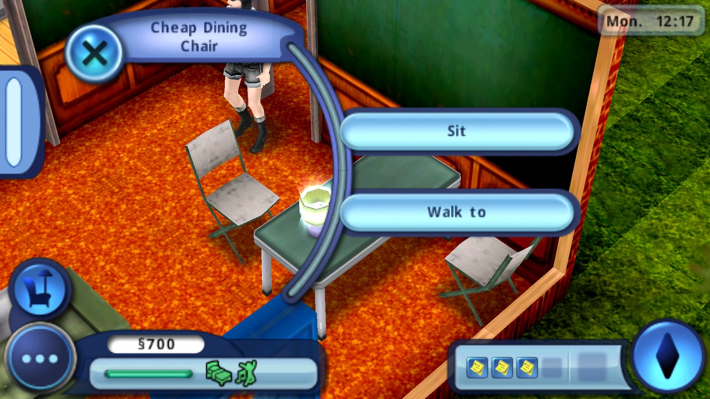
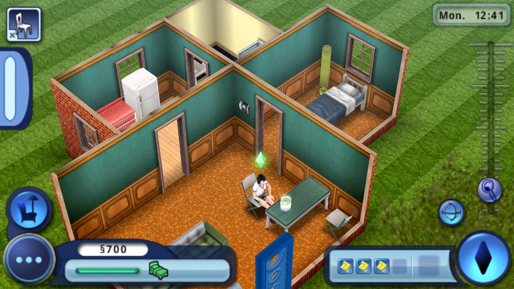

# Object action runtime acceptance — 0.1.11

**C3 attempt 2 passed the required runtime gate on 2026-10-31 UTC.** The root agent directly reviewed the screenshots and full archive/log, with independent agreement from the Android runtime reviewer and a separate image/log reviewer. Root authorized publishing the exact tested C3 bytes. Historical C2 and C3 attempt 1 failures remain preserved below.

| Accepted artifact | Verified value |
| --- | --- |
| APK / bytes | `0.1.11-object-actions` / `76,762,457` |
| APK SHA-256 | `3f7698294ace0e7a78bb32524811ae237701395dc87184102cdc4c47534d07f5` |
| Native shim SHA-256 | `d0f375b7e74b8174f0f00472a3b3eb6f44f0b5d2f48ffcfa1f03e812b236cf68` |
| Source checkpoint | `02b1375300f541f3d092b3d1720d16031f4b7a06` |
| Workflow / attempt | [run 41215805134](https://github.com/Russianranger/s3ce/actions/runs/41215805134) / **2**, job success |
| Full evidence archive | [artifact 13048233710](https://github.com/Russianranger/s3ce/actions/runs/41215805134/artifacts/13048233710), `122,659,146` bytes |
| ZIP SHA-256 | `95448d02d49e77fd5a3175e000673f6227411e163436492bdeaf5d0e097f3c8a` |

## C3 accepted progression and shutdown

Ordinary Android input completed female creation, five compatible traits, Alex naming, house gameplay, Save and Quit, process restart, and loading the saved Sim: **PID 4010 → 11395**. After normal camera zoom, the visible **Cheap Dining Chair / Sit** action was selected. Frame 8 shows only approach/queue start; completion is established by frame 10's settled seated pose, bent knees, and matching chair action icon at **Mon. 12:19**, after the menu at **Mon. 11:36**. A timed Wish was acknowledged through its visible control before that unobstructed pose capture.

The same run then used normal Pause → **Save and Quit to menu** → green Save confirmation → main-menu **Quit** → green Quit confirmation. Save files `sim3dat0` (2,562 bytes) and `sim3set` (90 bytes) changed modification time **15:54 → 16:07 UTC** on the post-action save. Save contents and game state were not edited by the harness.

At **16:09:47.743 UTC**, PID 11395 logged `Native code done.  Shutting down`; at **16:09:47.744**, it logged `calling finish on activity`. Frame 16 shows CompatActivity resumed, Main no longer resumed, and the idle package PID 11395 retained. The complete live log has **zero** Java/native fatal, SIGSEGV, SIGABRT, ANR, `am_crash`, or `am_anr` matches, and **zero** late `generateAudio called when airplay not initialised` warnings. The native Quit guard passed, and command 17 `finish` collected the completed evidence.

The unmodified automated `acceptance.json` retains `status: runtime-progression-observed-awaiting-visual-review` and **`gate_passed:false`** by design. Manual visual acceptance is recorded separately in the [evidence index](object-actions-runtime-evidence.json). Original acceptance SHA-256: `f7bd69ee54bf4139ebb39fcee9ca920c5996db3480c15c575178ab84871ae2a1`; complete live log SHA-256: `f98da5d1cd70945f050add430b09a9e462f3e7e28ddf84ef98002fd2735bc02e`. All 17 raw frame hashes and every accepted UI command are indexed.

C3 used the same API 30 Google APIs x86 revision 16, ARMv7 `libndk_translation.so`, Emulator 31.1.4/KVM12/SwiftShader environment and full 1920×1080 native canvas detailed in the historical table below. The exact tested object is **Chair, not Sofa**. Android Home/reopen was **not exercised in C3**; no Android pause/resume claim is made from this run. Physical hardware and Android 13–16 remain outside this emulator evidence. C3 attempt 1's translator abort is retained below; only identical-byte attempt 2 passed.

## C3 raw checkpoint PNGs

| Observation | Full attempt 2 archive member | Raw PNG SHA-256 |
| --- | --- | --- |
| 7: Chair menu | `live-frame-007/screen.png` | `14fe8a66404663f297735414ec785cb2362fe4e8b01340162fa8a62e5124ef1e` |
| 8: Accepted action, approach only | `live-frame-008/screen.png` | `19d7542b86e662b83b8f0a937336b17e30ae6a515347a76fa389e63abc8e3ce9` |
| 10: Completed Sit | `live-frame-010/screen.png` | `95e8fadf72094d046e7c84542e964dd227eb0bd69ac9d0afc58b74e927631a00` |
| 12: Post-action Save confirmation | `live-frame-012/screen.png` | `51a2235450b01d8ac8c84d6364aba1be82b0e1f9a9c03e5330da28985d0ebbb0` |
| 14: Main menu | `live-frame-014/screen.png` | `fb251e3d73ac22806629ff8228fa2a05e115a535964117969e83123a1dac9c31` |
| 15: Native Quit confirmation | `live-frame-015/screen.png` | `ede149930f09e9f8d05e92b5807770b805852ef4e1dcf2fd738eb82a95801b57` |
| 16: Clean return to Compat | `live-frame-016/screen.png` | `192f2addd7ba2aa193f4c1f3b3d4f10bc6141bb08f2a91865416663ffd7ee5f4` |

## C3 documentation previews

These JPEG previews are resized from the original 1920×1080 PNGs to 1280×720, quality 90, each below 350 KB. Only resizing and JPEG encoding were applied; raw hashes above identify the original evidence.

### C3 — visible object action

Original `live-frame-007/screen.png`, SHA-256 `14fe8a66404663f297735414ec785cb2362fe4e8b01340162fa8a62e5124ef1e`.

### C3 — completed Sit

Original `live-frame-010/screen.png`, SHA-256 `95e8fadf72094d046e7c84542e964dd227eb0bd69ac9d0afc58b74e927631a00`.

### C3 — launcher after clean native Quit

Original `live-frame-016/screen.png`, SHA-256 `192f2addd7ba2aa193f4c1f3b3d4f10bc6141bb08f2a91865416663ffd7ee5f4`. This image is paired with the successful native Quit guard and zero-fatal complete log; a launcher screenshot alone does not prove clean shutdown.

## Historical C2 receipt

**C2 is not released. Actual Chair Sit passed; clean Quit failed.** The complete workflow remains red, and its original `acceptance.json` remains `status: blocked`, `gate_passed: false`. C3 attempt 1 stopped before UI in the emulator ARM translator; the identical-byte attempt 2 subsequently passed as recorded above.

On 2026-10-31 UTC, the root agent, Android runtime reviewer, and a separate image reviewer directly inspected the transition from a visible **Cheap Dining Chair / Sit** menu to Alex seated on that chair. This establishes an executed object action beyond menu dismissal. **Retro Sofa was not directly selected in C2.**

### Exact tested bytes and runtime

| Item | Verified value |
| --- | --- |
| Candidate | C2, `0.1.11-object-actions`, version code `111` |
| Package / ABI | `io.github.russianranger.s3ce` / `armeabi-v7a` |
| APK bytes | `76,762,457` |
| APK SHA-256 | `a5a98513afa16520bc86b2aff67fda2b68d3505755d57e69e75cd6499453aa48` |
| Native shim SHA-256 | `d0f375b7e74b8174f0f00472a3b3eb6f44f0b5d2f48ffcfa1f03e812b236cf68` |
| Source checkpoint | `c49b2cdf62ee73b15a3dab3b90b79af40689e4a6` |
| Android guest | Android 11 / API 30 Google APIs x86, revision 16 |
| ABI list / native bridge | `x86,armeabi-v7a,armeabi` / `libndk_translation.so` |
| Emulator | `31.1.4.0`, build `7920983` |
| Host acceleration / renderer | GitHub-hosted `ubuntu-latest`, KVM version 12 / `swiftshader_indirect` |
| Guest / native canvas | 4 cores, 3,072 MiB RAM, 4,096-byte pages / `[0,0,1920,1080]` |
| System image bytes / SHA-256 | `3,232,759,808` / `48e9d853b2ab892222889225629ad17cd53c0239c7db32798d134d10870a78fe` |

The controller used ordinary Android touch, text, launch, and process restart input. It did not write game memory, phases, or save contents. The normal game created and saved Alex. Save access for evidence was a read-only file listing. Commands were bound to the actual run, sequence, raw PNG hash, and canvas; the root agent alone selected commands after reviewing each frame.

This is API 30 emulator evidence with ARMv7 translation. It does not establish native ARM execution, physical-device acceptance, or Android 13–16 support.

### Original archive

[Workflow run 41212609908](https://github.com/Russianranger/s3ce/actions/runs/41212609908), [full artifact 13047588702](https://github.com/Russianranger/s3ce/actions/runs/41212609908/artifacts/13047588702), `android-runtime-41212609908-1`:

- ZIP bytes: `112,228,778`
- ZIP SHA-256: `e690ad48715216e3af370d33f4a0cb429c937c5016281fb1d2fa704b3bee24ab`
- Original `acceptance.json` SHA-256: `0452cfa4534587ba5f9d6eac18fde8f33a16d2c00011fc477eb5cec9daa1f66f`
- Complete `logcat-live.txt` SHA-256: `ba0d4c779edc92a52625e189c095586ca22c95b4b4a067bde30d39d4fdc92793`

The [evidence index](object-actions-runtime-evidence.json) records all 14 raw frame hashes, original checkpoint observations, every accepted UI command, environment details, preview hashes, and the rejected Quit observation. Archive member paths below are relative to the extracted full ZIP.

### Observed progression and actual Sit

The normal prefix completed female creation, five compatible traits, Alex naming, the new-game confirmation, house gameplay, **Save and Quit to menu**, process restart, and loading the existing Alex slot. The game PID changed **4099 → 12153**. The loaded house remained interactive.

After a normal camera zoom, selecting the dining chair opened the exact **Cheap Dining Chair** menu with **Sit** and **Walk to**. A timed Wish interrupted the first attempted selection; the reviewer accepted that visible Wish, then selected the visible Sit control again. Accepted command 7 was a normal tap at `[1235,353]` bound to frame 6's raw PNG hash.

Frame 6 shows Alex standing beside an empty chair and the actual Sit control at **Mon. 12:17**. Frame 7 shows Alex's hips on the selected chair, bent knees at the table, and the matching chair action icon in the top-left HUD at **Mon. 12:41**. Both frames retain PID 12153 and zero fatal/ANR matches at that point. This is the positive object-action result.

The reviewer then used ordinary Pause → **Save and Quit to menu** → the visible green confirmation. `sim3dat0` remained 2,562 bytes and `sim3set` 90 bytes; their modification time changed **15:10 → 15:26 UTC** on this post-action save.

### Rejected clean Quit and exact audio failure

The normal main-menu **Quit** control opened **Are you sure you want to quit the game?** Accepting its visible green check returned from native Main and requested Activity finish, but a queued audio callback then crashed the Java main thread:

| UTC time | Original log evidence |
| --- | --- |
| 15:27:49.440 | `Native code done.  Shutting down` |
| 15:27:49.441 | `calling finish on activity` |
| 15:27:49.480 | `JNI method generateAudio called when airplay not initialised` |
| 15:27:49.481 | `FATAL EXCEPTION: main` |

The exception is **`java.lang.NullPointerException`**, invoking `android.media.AudioTrack.write(short[], int, int)` on a null object reference at **`com.ideaworks3d.airplay.SoundPlayer.onPeriodicNotification(SoundPlayer.java:91)`**, dispatched by `AudioTrack$NativePositionEventHandlerDelegate$1.handleMessage`.

Frame 13 visibly shows CompatActivity, with both native-return and Activity-finish markers present, but `fatal_or_anr_count:1` and an empty package PID. The harness correctly rejected this as **`RuntimeError: Normal native Quit did not finish without fatal/ANR evidence`**. Compat being visible does not establish clean shutdown. Its cached `SceneGame` field is the last sampled native observation and is stale after Quit.

The complete live log contains **one `FATAL EXCEPTION`**, and zero `Fatal signal`, `SIGSEGV`, `SIGABRT`, `ANR in`, `am_crash`, or `am_anr` matches. The native renderer teardown reached its normal return in this path; the later Java audio failure still blocks the overall Quit gate and release of C2.

### Raw checkpoint PNGs

| Observation | Full archive member | Raw PNG SHA-256 |
| --- | --- | --- |
| 6: Chair menu, standing Sim | `live-frame-006/screen.png` | `ce4e9a4fabfbe809affc40f1256d21789688b9e2ca499509b0bbd7491dfde76c` |
| 7: Completed Sit, seated Sim | `live-frame-007/screen.png` | `5aa234152451b1e36157433a166bcc4f9eaea0e11b4767e4c8379d5d886c3655` |
| 8: Ordinary Pause menu | `live-frame-008/screen.png` | `a8bc174021a0332c2a346b4aba8e6d792f3c47ea8e6fa6e5f42a4449f90b93b1` |
| 9: Save confirmation | `live-frame-009/screen.png` | `1c2aa459a31754fd30eb515f79f299bdf402aa766a21765e7834eed96c8dee95` |
| 10: Return toward main menu | `live-frame-010/screen.png` | `ec6117536931c793fac9bf1e7ab18271f71ea3bb64709d9a59b2925a573507b5` |
| 11: Main menu | `live-frame-011/screen.png` | `6e5af115041dfb54622fed7f75e83b73852c5b529de35c2e043f7503c21d6eb0` |
| 12: Native Quit confirmation | `live-frame-012/screen.png` | `87d7a7d46263ee43d8ce87f1597c42c5ba404e36ba575b5eea43bc6c52fc05ed` |
| 13: Compat launcher after Java fatal | `live-frame-013/screen.png` | `557dd38760b35e9ed9eea1443a0f0e4c5ce3e0551b6e75d720c8ecbfcdf2e2be` |

### Documentation previews

These are **JPEG previews** of the original technical screenshots: resized from 1920×1080 to 1280×720 with JPEG quality 90. Only resizing and JPEG encoding were applied. Each is below 350 KB. The raw PNGs and hashes above remain the original evidence.

#### C2 — actual Chair Sit menu

Original: `live-frame-006/screen.png`, SHA-256 `ce4e9a4fabfbe809affc40f1256d21789688b9e2ca499509b0bbd7491dfde76c`.

#### C2 — actual seated Sim and chair action icon

Original: `live-frame-007/screen.png`, SHA-256 `5aa234152451b1e36157433a166bcc4f9eaea0e11b4767e4c8379d5d886c3655`.

## C3 first attempt — startup translation abort

C3 contains the targeted Java audio lifecycle fix and the same native shim bytes as C2. Its first run did **not** reach the main menu or any gameplay gate. Preserve this separately from C2's actual Sit result.

| Item | Verified value |
| --- | --- |
| C3 APK SHA-256 | `3f7698294ace0e7a78bb32524811ae237701395dc87184102cdc4c47534d07f5` |
| Source / attempt | `02b1375300f541f3d092b3d1720d16031f4b7a06` / run 41215805134, attempt 1 |
| Full archive | [artifact 13047846272](https://github.com/Russianranger/s3ce/actions/runs/41215805134/artifacts/13047846272), `1,119,687` bytes |
| ZIP SHA-256 | `0b133b784d29775c62856e0b0b9efec51b0e3e580cfb2e6eaf7cf20587b87152` |

At **15:40:12.725 UTC**, PID 4187 / Thread-2 received SIGABRT from `libndk_translation.so` after its compiler asserted **`IsAligned(offset, GetFormatSize(src->format()))`**, `ir.h:716`. The host backtrace passes through `PutInsn`, `InsnBuilder::Put`, `SemanticsDecoder::VADDL`, and `ArmDecoder::TranslateArmInsn`. No Java `FATAL EXCEPTION` occurred in this attempt.

The harness reported `Cannot establish native SurfaceView/Main window bounds` because the process had already aborted before its first screenshot; the actual cause is preserved in the live log. Successful C2 boot has the same initial GL texture/error diagnostic and continues; that shared error alone does not establish a C3 regression. Cause remains under review. One bounded rerun of **identical C3 bytes/source** was started as attempt 2 and subsequently passed the required checks above. No app bytes changed between attempts; attempt 1 remains a failed, unaccepted observation.
