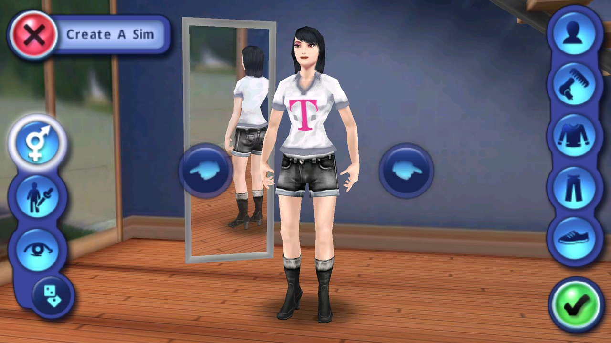
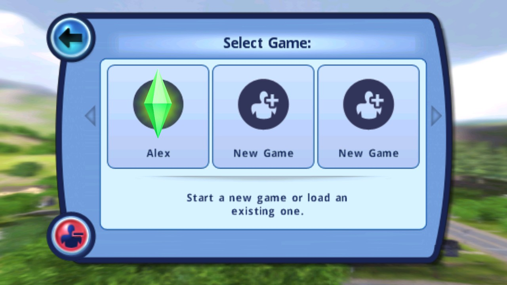
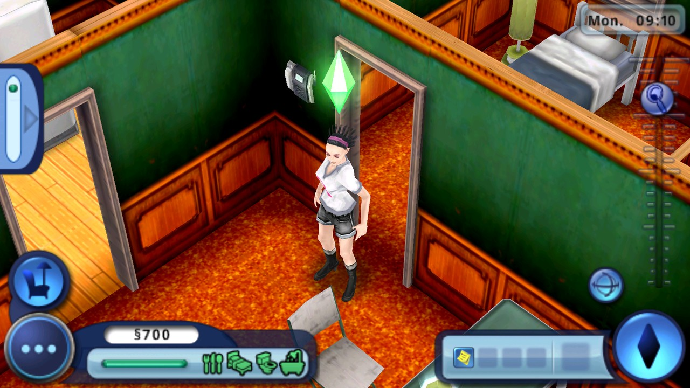

# Android runtime acceptance — 0.1.10

Accepted on **2026-10-31 UTC** by the root agent after direct screenshot review, with independent agreement from the Android runtime and Java compatibility reviewing agents. The required checks passed manual review: visible female customization, character creation into gameplay, normal Save and Quit, process restart, and loading the saved Sim into live gameplay.

The tested APK bytes were unchanged throughout this acceptance. No game-state memory, phase, or save-file values were written by the harness; progression used ordinary Android touch, text, Home, and launch input. Save-file access for evidence was read-only metadata inspection.

## Tested artifact and runtime

| Item | Verified value |
| --- | --- |
| Package / version | `io.github.russianranger.s3ce` / `0.1.10-character-creation` / version code `110` |
| Min / target SDK | `26` / `28` |
| APK bytes | `76,762,457` |
| APK SHA-256 | `45335ca99a15e2b26dcbaeb0547cb2edc184eb7fa302446abae22dd455fb40fb` |
| Android guest | Android 11 / API 30, Google APIs **x86 revision 16** |
| ABI list | `x86,armeabi-v7a,armeabi` |
| ARMv7 bridge | `libndk_translation.so` |
| Emulator / acceleration | `31.1.4.0`, build `7920983`; KVM version 12 |
| Renderer | `swiftshader_indirect` |
| Guest configuration | 4 cores, 3,072 MiB RAM; 4,096-byte pages |
| Verified native canvas | `[0,0,1920,1080]` |
| Host | GitHub-hosted `ubuntu-latest` |
| System image bytes / SHA-256 | `3,232,759,808` / `48e9d853b2ab892222889225629ad17cd53c0239c7db32798d134d10870a78fe` |

This run validates the Android 11 emulator with ARMv7 translation. Physical Thor/Retroid hardware, native ARM execution, and Android 13–16 were not tested here. ARM32 support and the port's 4 KiB page constraint remain; this is not a universal ARM64 build. The reported customization crash did not recur in the exercised female, hairstyle, and same-process reopen path; this does not establish every customization path or device.

## Original evidence archives

| Archive | Workflow / artifact | ZIP bytes | ZIP SHA-256 |
| --- | --- | ---: | --- |
| CI4 appearance | [run 41169033872](https://github.com/Russianranger/s3ce/actions/runs/41169033872) / [artifact 13030945223](https://github.com/Russianranger/s3ce/actions/runs/41169033872/artifacts/13030945223) | 29,698,051 | `2dba7def459d7e4a9a0c29049bdcaf1763241ccf0772e02a0d9534caf266e98f` |
| CI11 full progression | [run 41177712451](https://github.com/Russianranger/s3ce/actions/runs/41177712451) / [artifact 13034306878](https://github.com/Russianranger/s3ce/actions/runs/41177712451/artifacts/13034306878) | 75,708,026 | `023886bf57225b276a261d3a447a125f2fe2129e8c08219712a7c7c24dfae30e` |

CI11 source commit: `296998918ae895b7dea2c33771847bfa7158819d`. Archive member paths below are relative to the corresponding extracted ZIP. Per-step `observation.json`, `native.log`, `app-files.txt`, and screenshots preserve the original observations. The [portable evidence index](runtime-acceptance-evidence.json) includes 15 raw PNG hashes, timestamps, PID/scene observations, save metadata, preview hashes, and environment details.

## Required progression observed

- Female gender selection and three hairstyle changes completed; Home/reopen preserved the customization in the same process. Visible toolbars and confirmation controls remained available.
- Five compatible traits, the name **Alex**, and the normal new-game confirmation led to the rendered house and full gameplay HUD.
- The ordinary Pause menu showed **Save and Quit to menu**. The visible Save Game confirmation was accepted, returning to the main menu in `SceneMenu`, state `5`.
- The app was force-stopped and relaunched: game PID **4210 → 15467**. The Select Game screen showed the existing **Alex** slot. Selecting it loaded `SceneGame` with the same female appearance and hairstyle, house, and `$700` HUD.
- A normal resumed interaction opened **Alex / Edit Appearance**. The visible game clock advanced **09:10 → 09:21 → 09:43** while the Sim's pose changed.
- Normal save files `sim3dat0` (2,562 bytes) and `sim3set` (90 bytes) changed modification time **06:52 → 06:58 UTC** on Save and Quit, then persisted across the process restart.
- The complete CI11 `logcat-live.txt` had **zero** matches for `FATAL EXCEPTION`, `Fatal signal`, `SIGSEGV`, `SIGABRT`, `ANR in`, `am_crash`, or `am_anr`.

## Automated result and manual acceptance

**CI11 remains red.** Its original `acceptance.json` retains `status: blocked`, `gate_passed: false`, and an empty checkpoint map because `run_plan` raised before returning that map. The per-step evidence above had already captured all required save/restart/load/interaction checks.

The sole final error was a 30-second Tesseract timeout in the optional `candidate-36-clear-resumed-gameplay-popups` step. Its screen was the valid **Alex / Edit Appearance interaction menu**, with live gameplay behind it. This was an onboarding-only OCR classifier applied after a successful ordinary interaction. The redundant final OCR step was removed from the future plan. The original failed workflow and evidence were preserved; root plus two independent reviewing agents accepted the required checks manually. No additional runtime or changed APK was needed for that decision.

## Raw checkpoint PNGs

| Observation | CI11 archive member | Raw PNG SHA-256 |
| --- | --- | --- |
| Same-process customization reopen, PID4210 | `candidate-11-reopen-female-customization-same-process/screen.png` | `70043ba7dce0fc812d2decee3ef7db2018b8f71d68a4bfed083409224c7e8dca` |
| Clear gameplay HUD | `candidate-28-clear-gameplay-onboarding-popups/screen.png` | `cddcb2047f3246514e857a2d194749d617299ee308ea7286ad6c46a3e1df26d3` |
| Save confirmation | `candidate-31-confirm-save-and-quit-verified/screen.png` | `49070cc65653a16bfa88014b99a439bed706c6f0beb395cf750420096254caca` |
| Saved to main menu, PID4210 | `candidate-31-confirm-save-and-quit/screen.png` | `4e91fa7c407ec6bf05d772c60364de8dc10d262f44e32449b1844fc7f9c711da` |
| Relaunched main menu, PID15467 | `candidate-32-restart-from-saved-game/screen.png` | `d13ca948d04265200335e0a95dbfa41db84e743968c385f48922127499648f83` |
| Existing Alex slot | `candidate-33-reopened-main-menu-start/screen.png` | `c2f8662e3cf4a2470755a1684228f07c7e3e7e9b6201216f2f0e8744ec428f99` |
| Resumed house and HUD, PID15467 | `candidate-34-load-existing-saved-female-sim/screen.png` | `609613680abf5cf62ec2a12f0a5831843f0d6590cd614de91ff8769e72cdadbd` |
| Live resumed interaction | `candidate-35-resumed-gameplay-floor-interaction/screen.png` | `ed280f802f3247cf0d99e443fc2f7d4673a4dab743444825bf21a5be88ca90c3` |
| Final valid interaction menu | `failure/screen.png` | `85eb4fcc1b2ff8f9938b2c6f6ad2aa421bfbba30e9692a046f8358fdd6e3a224` |

## Documentation previews

These are **JPEG previews**, resized from the original 1920×1080 PNGs to 1280×720 using JPEG quality 90. Only resizing and JPEG encoding were applied. Use the archive member and raw PNG SHA-256 for the original technical evidence.

### CI4 — visible female appearance controls

[Original CI4 archive](https://github.com/Russianranger/s3ce/actions/runs/41169033872/artifacts/13030945223), member `candidate-05-toggle-female-appearance/screen.png`. Raw PNG SHA-256: `5a11323cf98f02fe26cb1fa6fa06df1677bb5f321c76263b990156a5622cfcd4`.

### CI11 — saved Alex slot after process restart

[Original CI11 archive](https://github.com/Russianranger/s3ce/actions/runs/41177712451/artifacts/13034306878), member `candidate-33-reopened-main-menu-start/screen.png`. Raw PNG SHA-256: `c2f8662e3cf4a2470755a1684228f07c7e3e7e9b6201216f2f0e8744ec428f99`.

### CI11 — resumed house gameplay

[Original CI11 archive](https://github.com/Russianranger/s3ce/actions/runs/41177712451/artifacts/13034306878), member `candidate-34-load-existing-saved-female-sim/screen.png`. Raw PNG SHA-256: `609613680abf5cf62ec2a12f0a5831843f0d6590cd614de91ff8769e72cdadbd`.
